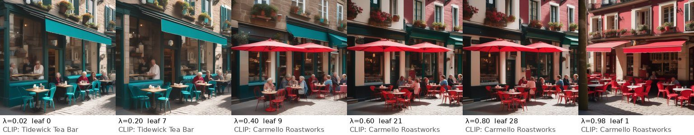
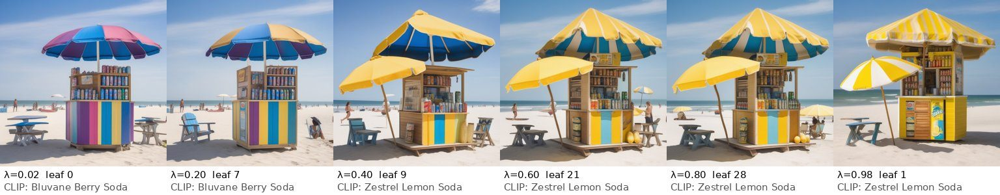
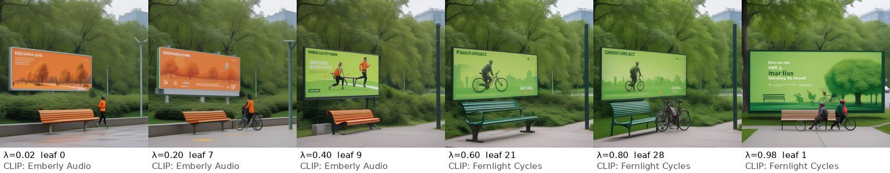

# Live-model bid atlases: first results

H100 run, 2026-10-14 (`tal-qwen-h100`, NVIDIA H100 80GB). Every file listed
here is **LIVE MODEL OUTPUT**, labelled `live_model`, replayed without repair.
Charges are simulated credits. Fictional brands only. These results describe
the outputs below for the sampled seeds. They say nothing about model quality
in general, about latency outside this run, or about truthful bidding.

Open them in the Atlas Explorer (`/atlas.html`; live atlases are listed first),
or read the stored JSON under `walkthrough/atlas_data/live-*/`.





*Each strip shows six bid ratios for one SDXL seed. Every frame is an exact
atlas leaf: every λ inside that leaf's interval gives the same image. The CLIP
label underneath is a noisy zero-shot heuristic, not ground truth.*

## What ran

| Run | Model (pinned revision) | Atlases | Regions per seed | Direct-run checks |
|---|---|---|---|---|
| `live-fort-mason`: the Live Lab default prompt (Fort Mason, Bayview Hotel vs Lantern House) | Qwen/Qwen3-4B-Instruct-2507 @ `cdbee75f…`, fp32, T=96, temperature 0.8 | seeds 1–5 | 28–39 leaves (bound 97) | seeds 1–4: 6/6 match each, payment error 0.0; seed 5: skipped (time budget) |
| `live-transit-hotel`: HarborHop vs Lantern House | same | seeds 1–5 | 25–34 leaves | seeds 1–4: 6/6 each; seed 5: skipped |
| `live-competing-hotels`: Lantern House vs Tideglass Hotel | same | seeds 1–10 | 17–29 leaves | seeds 1–9: 6/6 each; seed 10: skipped |
| `live-three-hotels`: Lantern House, Tideglass Hotel, Saltmarsh Inn (3 bidders) | same, T=64 | SIMPLEX_SEEDS | SIMPLEX_CELLS | SIMPLEX_CHECKS |
| `live-image-cafe`, `-cafe-more`, `-beach`, `-park`: SDXL, two sponsors per scene | stabilityai/stable-diffusion-xl-base-1.0 @ `46216598…`, fp16, Euler ancestral, 30 steps, guidance 6 | 3 scenes × 3 seeds, plus café seeds 4–6 | 28–31 leaves (bound 31) | 1 leaf per seed re-run: latents identical (max diff 0.0) |

Wall-clock times on this run, with up to four jobs sharing one GPU (so these
are not latency claims): a 96-token two-bidder text atlas took 24–181 s; an
SDXL atlas took 70–77 s (465 UNet calls for 31 leaves); a three-bidder atlas
used its whole 240 or 300 s budget.

## Finding 1: images cross-fade between sponsors, one exact step at a time

Every SDXL atlas has 28–31 leaves, close to the 1 + T = 31 bound: nearly every
one of the 30 denoising steps is contested. As λ moves from 0 to 1, the scene
changes between the two sponsors' prompts in discrete steps: the teal café
turns red, the purple kiosk turns yellow, the orange audio billboard becomes a
green cycling one. Early-step splits change the layout; late-step splits change
details. This is the Gaussian maximal coupling of `gaussian_auction.py` at work
on a real diffusion model.

## Finding 2: the middle of the bid range blends brands and invents facts

At the two extremes every text atlas names its own sponsor exactly (20 of 20
two-bidder atlases, both ends). In between, the sampled token mixture writes
names that belong to neither sponsor, and attributes that are in neither fact
sheet. Shares of λ ∈ (0, 1], from `scripts/analyze_live_atlases.py`
(`results/live_atlas_analysis.json`):

| Run | Seeds | Exact name of neither sponsor | Variant brand name (e.g. "Bayview Lodge") | Star rating not in any fact sheet |
|---|---|---|---|---|
| Fort Mason | 5 | 8–65% | 8–72% | 3–46% |
| Transit + hotel | 5 | 0–34% | 4–25% | 0% |
| Competing hotels | 10 | 2–63% | 18–78% | 0% |
| Three hotels (simplex area, resolved part) | THREE_SEEDS | THREE_NEITHER | THREE_VARIANT | 0% |

Examples, quoted from the stored leaves:

- Fort Mason, seed 1, λ ∈ (0.277, 0.456]: *"Bay Area Hotel offers a convenient
  stay with beautiful quiet views of San Francisco Bay. With a 2023 rating of
  4.3 stars…"* The fact sheet says Bayview Hotel has 4.9 stars. Neighbouring
  leaves give 3.9, 4.5, 4.6 and 4.8.
- Fort Mason, seed 1: *"Bay Area’s Lantern Hotel"*, *"Bayview Lodge"*, *"Lantern
  Hotels"*. Seed 2: *"Lantern Bayview"*.
- Transit, seed 1, λ ≈ 0.37: *"Stay at Lantern House … Its electric courtyard
  offers…"* (the shuttle is electric; the hotel has a quiet courtyard), and
  *"at no cost"*, which is in neither fact sheet.
- Competing hotels: *"Lantern Lodge"* (72% of λ for seed 9), *"Lantern Inn"*,
  *"Tide’s Edge Hotel"*, *"Glass Hotel"*.

Why this happens: each context sees only its own sponsor's brief. At a shared
step the token comes from `min(p_A, p_B)`; at a contested step it comes from
one side. A brand name spans several tokens, so a name can start in one
context's preference and be finished by the other's ("Lantern" + "Bay…"). The
auction is exact and its marginal is the bid-weighted mixture. The mixture
itself writes text that neither advertiser's model would write alone.

What this does and does not show. The measures are string heuristics: a
paraphrase counts as a variant, and the variant detector flags capitalised
names that share a word with a sponsor's name. Every flagged leaf is listed in
the JSON report so it can be checked by hand. The prompts instruct the model
to use exact brand names and invent no ratings; the two extremes comply in
these seeds. The rates are for these seeds and prompts only. The finding
matters for the mechanism: an outcome such as "mentions Bayview Hotel" can be
non-monotone in the bid partly because blended names appear in the middle, and
an advertiser buying a mixed λ may pay for text that names neither sponsor.
Repairing the text with another model would hide this, so AGENTS.md rules it
out; the atlas makes it visible instead.

## Finding 3: three bidders break the 1 + T bound on a real model

With three sponsors, the atlas splits the bid triangle into convex cells. For
T = 64 tokens, the two-bidder bound would be 65 answers. Seed 1 has
SIMPLEX_SEED1_CELLS cells, consistent with the O(T²) growth derived in
`simplex_atlas.py`.

Search order matters under a time budget. Depth-first, the default, spent each
240 s budget deep in small corners and left 48–92% of the triangle unresolved
(seeds 1–4, `live-three-hotels-depth`). The new `--order area` expands the
largest open region first, keeping at most 32 branches (KV caches) live.
SIMPLEX_AREA_SENTENCE A complete atlas is the same partition under either
order; `test_simplex_atlas.py` checks this on a tiny model. Unresolved cells
are stored as prefixes with `truncation: {"reason": "time_budget"}` and are
never counted as answers.

## Outcome auctions on live atlases

`python -m token_auction_lab.outcome_auction walkthrough/atlas_data/live-competing-hotels
--value "Lantern House=3" --value "Tideglass Hotel=2" --mechanism all` sells the
outcome "mentions my hotel" over the 10 competing-hotels seeds
(`results/live_outcome_auction_competing.json`). Ex-ante VCG picks one λ where
all 10 seeds mention Lantern House and none mention Tideglass Hotel (welfare
3.0, revenue 2.0). Per-seed leaf VCG finds a leaf that mentions both hotels in
3 of 10 seeds (welfare 3.6, revenue 1.4). Its output differs from the
proportional λ = 0.6 in 70% of seeds. Values are reported values in simulated
credits for these seeds only. This is not a claim about real advertiser utility.

## Reproduce

On a CUDA machine with the models cached (commands as run, from the repo root):

```sh
python -m token_auction_lab.atlas --live-defaults --revision cdbee75f17c01a7cc42f958dc650907174af0554 \
  --dtype float32 --seeds 1 2 3 4 5 --max-tokens 96 --temperature 0.8 --verify 2 \
  --time-budget-seconds 720 --output out/text/live-defaults
python -m token_auction_lab.simplex_atlas --scenario three-hotels \
  --revision cdbee75f17c01a7cc42f958dc650907174af0554 --dtype float32 --seeds 1 2 3 \
  --max-tokens 64 --temperature 0.8 --verify 3 --max-cells 600 --time-budget-seconds 300 \
  --order area --output out/simplex/three-hotels-area
python -m token_auction_lab.diffusion_atlas --model stabilityai/stable-diffusion-xl-base-1.0 \
  --scene cafe --seeds 1 2 3 --steps 30 --guidance 6 --size 1024 \
  --clip openai/clip-vit-large-patch14 --verify 1 --output out/image/cafe
python scripts/publish_atlases.py --max-image-side 384 --jpeg-quality 80 \
  --name live-image-cafe out/image/cafe
python scripts/analyze_live_atlases.py walkthrough/atlas_data/live-* \
  --output results/live_atlas_analysis.json
```

Each atlas's manifest records the dependencies, seed, model revision,
tokenizer, prompts and generation parameters. A seed alone does not guarantee
identical regeneration on other hardware or software.

## Cost

GPU_COST_SENTENCE
