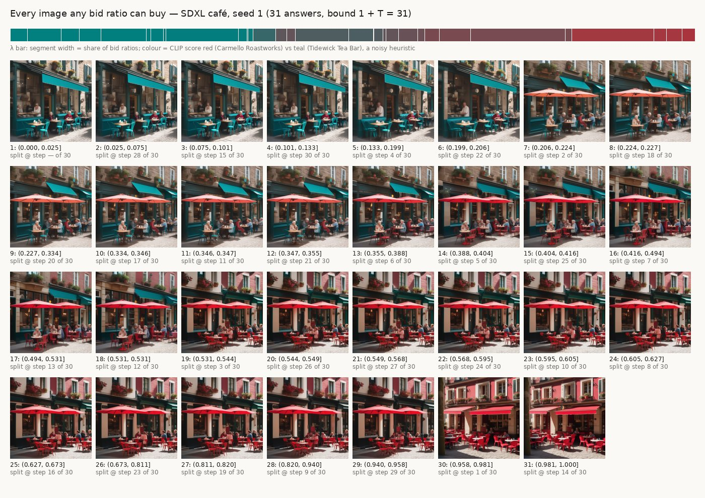
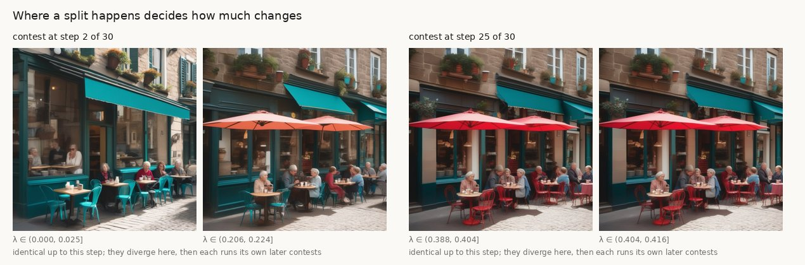
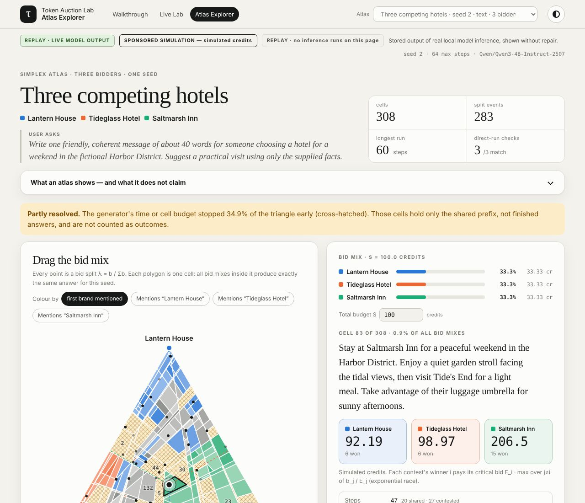

# Live-model bid atlases: first results

H100 run, 2026-10-14 (`tal-qwen-h100`, NVIDIA H100 80GB). Every file listed
here is **LIVE MODEL OUTPUT**, labelled `live_model`, replayed without repair.
Charges are simulated credits. Fictional brands only. These results describe
the outputs below for the sampled seeds. They say nothing about model quality
in general, about latency outside this run, or about truthful bidding.

Open them in the Atlas Explorer (`/atlas.html`; live atlases are listed first),
or read the stored JSON under `walkthrough/atlas_data/live-*/`.


*Each strip shows six bid ratios for one SDXL seed. Every frame is an exact
atlas leaf: every λ inside that leaf's interval gives the same image. The CLIP
label underneath is a noisy zero-shot heuristic, not ground truth.*

## What ran

| Run | Model (pinned revision) | Atlases | Regions per seed | Direct-run checks |
|---|---|---|---|---|
| `live-fort-mason`: the Live Lab default prompt (Fort Mason, Bayview Hotel vs Lantern House) | Qwen/Qwen3-4B-Instruct-2507 @ `cdbee75f…`, fp32, T=96, temperature 0.8 | seeds 1–5 | 28–39 leaves (bound 97) | seeds 1–4: 6/6 match each, payment error 0.0; seed 5: skipped (time budget) |
| `live-transit-hotel`: HarborHop vs Lantern House | same | seeds 1–5 | 25–34 leaves | seeds 1–4: 6/6 each; seed 5: skipped |
| `live-competing-hotels`: Lantern House vs Tideglass Hotel | same | seeds 1–10 | 17–29 leaves | seeds 1–9: 6/6 each; seed 10: skipped |
| `live-three-hotels`: Lantern House, Tideglass Hotel, Saltmarsh Inn (3 bidders) | same, T=64 | seeds 1–3, `--order area`, 300 s each (plus seeds 1–4 depth-first, 240 s each, as `live-three-hotels-depth`) | 276–310 cells (area order), 76–196 (depth-first); budget-truncated, so lower bounds | 3/3 sampled cells per seed match tokens and charges |
| `live-image-cafe`, `-cafe-more`, `-beach`, `-park`: SDXL, two sponsors per scene | stabilityai/stable-diffusion-xl-base-1.0 @ `46216598…`, fp16, Euler ancestral, 30 steps, guidance 6 | 3 scenes × 3 seeds, plus café seeds 4–6 | 28–31 leaves (bound 31) | 1 leaf per seed re-run: latents identical (max diff 0.0) |

Wall-clock times on this run, with up to four jobs sharing one GPU (so these
are not latency claims): a 96-token two-bidder text atlas took 24–181 s; an
SDXL atlas took 70–77 s (465 UNet calls for 31 leaves); a three-bidder atlas
used its whole 240 or 300 s budget.

## Finding 1: images cross-fade between sponsors, one exact step at a time

Every SDXL atlas has 28–31 leaves, close to the 1 + T = 31 bound: nearly every
one of the 30 denoising steps is contested. As λ moves from 0 to 1, the scene
changes between the two sponsors' prompts in discrete steps: the teal café
turns red, the purple kiosk turns yellow, the orange audio billboard becomes a
green cycling one. This is the Gaussian maximal coupling of `gaussian_auction.py`
at work on a real diffusion model.

Measured over all 12 seeds (356 splits):

- **Almost every step is contested.** The two prompts' noise proposals sit a
  median 6.1 noise widths apart (range 2.9–38). The shared mass is
  `2·(1 − Φ(δ/2))`: about 0.2% at the median and at most 15%. So the two
  sponsors almost never agree on a step for free.
- **Early contests change the layout; late ones change details.** Compare the
  two final images whose histories diverge at a given step (mean absolute
  grey-level difference, 0–255, at 128×128 px). Divergence at steps 1–5 gives
  21.7. Steps 6–10 give 6.1, steps 11–15 give 2.1, and steps 21–30 give 0.3–0.4.
- **The hand-over is not always clean.** CLIP's top label switches exactly
  once between the two sponsors in 6 of 12 seeds; in the others it flips 2–5
  times along λ. The image's look need not be monotone in the bid, as with
  text. CLIP is noisy, so this is an upper bound on real flips.



- **Leaf order in λ is not step order.** In café seed 1, the step-1 contest
  splits at λ ≈ 0.958, so the last two leaves (λ > 0.958) have a different
  street layout from everything below them.

## Finding 2: the middle of the bid range blends brands and invents facts

At the two extremes every text atlas names its own sponsor exactly (20 of 20
two-bidder atlases, both ends). In between, the sampled token mixture writes
names that belong to neither sponsor, and attributes that are in neither fact
sheet. Shares of λ ∈ (0, 1], from `scripts/analyze_live_atlases.py`
(`results/live_atlas_analysis.json`):

| Run | Seeds | Exact name of neither sponsor | Variant brand name (e.g. "Bayview Lodge") | Star rating not in any fact sheet |
|---|---|---|---|---|
| Fort Mason | 5 | 8–65% | 8–72% | 3–46% |
| Transit + hotel | 5 | 0–34% | 4–25% | 0% |
| Competing hotels | 10 | 2–63% | 18–78% | 0% |
| Three hotels (simplex area, resolved part) | 3 (area order) | 22–88% of the resolved area | 30–88% of the resolved area | 0% |

Examples, quoted from the stored leaves:

- Fort Mason, seed 1, λ ∈ (0.277, 0.456]: *"Bay Area Hotel offers a convenient
  stay with beautiful quiet views of San Francisco Bay. With a 2023 rating of
  4.3 stars…"* The fact sheet says Bayview Hotel has 4.9 stars. Neighbouring
  leaves give 3.9, 4.5, 4.6 and 4.8.
- Fort Mason, seed 1: *"Bay Area’s Lantern Hotel"*, *"Bayview Lodge"*, *"Lantern
  Hotels"*. Seed 2: *"Lantern Bayview"*.
- Transit, seed 1, λ ≈ 0.37: *"Stay at Lantern House … Its electric courtyard
  offers…"* (the shuttle is electric; the hotel has a quiet courtyard), and
  *"at no cost"*, which is in neither fact sheet.
- Competing hotels: *"Lantern Lodge"* (72% of λ for seed 9), *"Lantern Inn"*,
  *"Tide’s Edge Hotel"*, *"Glass Hotel"*.

Why this happens: each context sees only its own sponsor's brief. At a shared
step the token comes from `min(p_A, p_B)`; at a contested step it comes from
one side. A brand name spans several tokens, so a name can start in one
context's preference and be finished by the other's ("Lantern" + "Bay…"). The
auction is exact and its marginal is the bid-weighted mixture. The mixture
itself writes text that neither advertiser's model would write alone.

What this does and does not show. The measures are string heuristics: a
paraphrase counts as a variant, and the variant detector flags capitalised
names that share a word with a sponsor's name. Every flagged leaf is listed in
the JSON report so it can be checked by hand. The prompts instruct the model
to use exact brand names and invent no ratings; the two extremes comply in
these seeds. The rates are for these seeds and prompts only. The finding
matters for the mechanism: an outcome such as "mentions Bayview Hotel" can be
non-monotone in the bid partly because blended names appear in the middle, and
an advertiser buying a mixed λ may pay for text that names neither sponsor.
Repairing the text with another model would hide this, so AGENTS.md rules it
out; the atlas makes it visible instead.

## Fix for finding 2: span hold removes the blended names

[SPAN_HOLD.md](SPAN_HOLD.md) describes an opt-in sampler. The winner of a contest
keeps writing the word or name its token starts, from its own distribution, so a
contest cannot land inside a brand name.

It was re-run on the same prompts, seeds and settings as above, on the same H100
(about 16 minutes, 2026-10-14). All 20 span-hold atlases matched direct span-hold
re-runs (`verification_status: all_match`). Only 6–10% of steps were held.

Mean share of the bid range (`results/span_hold_comparison.json`):

| Scenario (paired seeds) | Variant brand name: reference → span hold | Neither exact name | Star rating in no fact sheet | Other number in no fact sheet |
|---|---|---|---|---|
| Fort Mason (5) | 44.6% → 0% | 36.6% → 0% | 18.6% → 0.9% | 77.5% → 75.2% |
| Transit + hotel (5) | 20.1% → 0% | 11.2% → 0% | 0% → 0% | 0% → 7.9% |
| Competing hotels (10) | 49.0% → 0% | 29.8% → 0% | 0% → 0% | 0% → 0% |

Variant names fell in every one of the 20 paired seeds.

What it does not fix:

- **Invented facts, as opposed to invented names.** Travel times and fares in the
  Fort Mason answers stay at about 75% of λ; they appear at the extreme bids too,
  so they come from each context, not from the mixing. Transit gained "15" and
  "100" on 8% of λ.
- **Attributes still mix across words.** For example, "a quiet rooftop courtyard"
  combines one hotel's courtyard with the other's rooftop.
- **One residual rating.** Fort Mason seed 1 still shows a 4.3 or 4.8 rating on 4%
  of λ, written by one sponsor's own context.

Span hold also moves where the brand changes hands. In Fort Mason seed 1,
"Bayview Hotel" appears for every λ above 0.116 under span hold, against mostly above 0.64 for the
exact name under the reference sampler. So it changes what a bid buys, not just
the spelling.

## Finding 3: three bidders break the 1 + T bound on a real model



*Seed 2 in the Atlas Explorer. Hue: the hotel each cell's answer names first,
grey if it names none exactly. Cross-hatched: unresolved within the 300 s
budget.*

With three sponsors, the atlas splits the bid triangle into convex cells. For
T = 64 tokens, the two-bidder bound would be 65 answers. The area-order atlases
have 276, 308 and 310 cells while still leaving a quarter to a third of the
triangle unresolved, so the full counts are higher. This is consistent with the
O(T²) growth derived in `simplex_atlas.py`.

Search order matters under a time budget. Depth-first, the default, spent each
240 s budget deep in small corners and left 48–92% of the triangle unresolved
(seeds 1–4, `live-three-hotels-depth`). The new `--order area` expands the
largest open region first, keeping at most 32 branches (KV caches) live.
With 300 s per seed it resolved 75%, 65% and 67% of the triangle (seeds 1–3),
against 52%, 8%, 21% and 20% for depth-first with 240 s (seeds 1–4). The
budgets differ, so this is not a controlled comparison. On the tiny test model
with an equal 6-cell budget, area order resolves 53% against 11%. A complete atlas is the same partition under either
order; `test_simplex_atlas.py` checks this on a tiny model. Unresolved cells
are stored as prefixes with `truncation: {"reason": "time_budget"}` and are
never counted as answers.

## Outcome auctions on live atlases

`python -m token_auction_lab.outcome_auction walkthrough/atlas_data/live-competing-hotels
--value "Lantern House=3" --value "Tideglass Hotel=2" --mechanism all` sells the
outcome "mentions my hotel" over the 10 competing-hotels seeds
(`results/live_outcome_auction_competing.json`). Ex-ante VCG picks one λ where
all 10 seeds mention Lantern House and none mention Tideglass Hotel (welfare
3.0, revenue 2.0). Per-seed leaf VCG finds a leaf that mentions both hotels in
3 of 10 seeds (welfare 3.6, revenue 1.4). Its output differs from the
proportional λ = 0.6 in 70% of seeds. Values are reported values in simulated
credits for these seeds only. This is not a claim about real advertiser utility.

## Reproduce

On a CUDA machine with the models cached (commands as run, from the repo root):

```sh
python -m token_auction_lab.atlas --live-defaults --revision cdbee75f17c01a7cc42f958dc650907174af0554 \
  --dtype float32 --seeds 1 2 3 4 5 --max-tokens 96 --temperature 0.8 --verify 2 \
  --time-budget-seconds 720 --output out/text/live-defaults
python -m token_auction_lab.simplex_atlas --scenario three-hotels \
  --revision cdbee75f17c01a7cc42f958dc650907174af0554 --dtype float32 --seeds 1 2 3 \
  --max-tokens 64 --temperature 0.8 --verify 3 --max-cells 600 --time-budget-seconds 300 \
  --order area --output out/simplex/three-hotels-area
python -m token_auction_lab.diffusion_atlas --model stabilityai/stable-diffusion-xl-base-1.0 \
  --scene cafe --seeds 1 2 3 --steps 30 --guidance 6 --size 1024 \
  --clip openai/clip-vit-large-patch14 --verify 1 --output out/image/cafe
python scripts/publish_atlases.py --max-image-side 384 --jpeg-quality 80 \
  --name live-image-cafe out/image/cafe
python scripts/analyze_live_atlases.py walkthrough/atlas_data/live-* \
  --output results/live_atlas_analysis.json
```

Each atlas's manifest records the dependencies, seed, model revision,
tokenizer, prompts and generation parameters. A seed alone does not guarantee
identical regeneration on other hardware or software.

## Cost

This run used about 46 minutes of one H100 (13:51–14:36 UTC) at $0.084 per
minute, about $3.90; the node was stopped by hand when the last export
finished. The earlier overnight wake (setup and downloads) cost about $1.45.
The provider showed $9.56 spent this month and $20.08 of prepaid credit left
afterwards. Nothing ran beyond the owner's balance.
